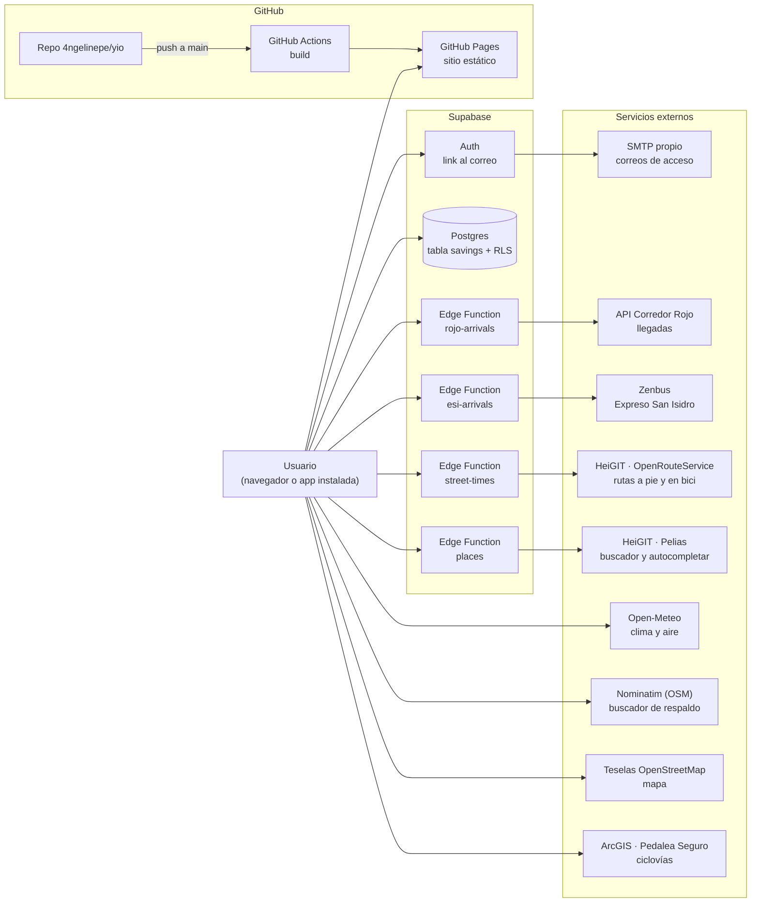
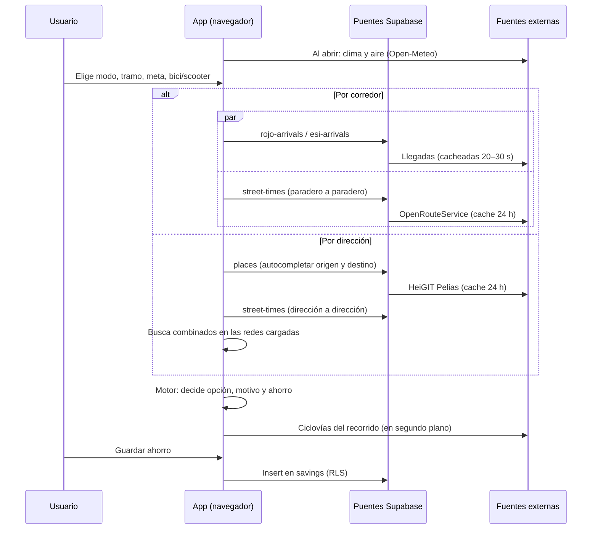

# YIO · Arquitectura

Documento técnico para socios y colaboradores. Explica cómo está construida YIO, qué servicios usa, dónde vive cada pieza y qué falta.

Estado al 12 de noviembre de 2026 · Fase 1 (uso personal y con amigos).

---

## 1. Qué es YIO

YIO ("Por el bienestar común") recomienda cómo moverse en Lima: caminar, bici, scooter, bus o Metro, frente al taxi como referencia de ahorro. Cruza el tramo con el clima, el aire, la hora punta y las llegadas del bus en vivo, y decide según la meta del usuario: **llegar rápido, ahorrar plata o moverse más**.

- **Fase 1 (hoy):** app web instalable (PWA) para uso propio y de un grupo cercano. Login sin contraseña e historial de ahorros en la nube.
- **Fase 2 (plan):** API y widget de marca blanca para billeteras digitales (TAPP). YIO no mueve dinero: solo recomienda y calcula el ahorro.

**En vivo:** https://4ngelinepe.github.io/yio/

## 2. Vista general



**Idea central:** el frontend es estático y hace casi todo en el navegador (motor de recomendación incluido). El backend se reduce a tres piezas: **Auth, una tabla y cuatro puentes**. Los puentes (Edge Functions) existen para tres cosas: ocultar claves, sortear CORS y cachear para no sobrecargar las fuentes. Son también la semilla de la API de la Fase 2.

## 3. Stack

| Capa | Tecnología |
|---|---|
| Frontend | React 18 + TypeScript + Vite |
| Estilos | Tailwind CSS v4 con tokens por marca (`[data-theme]`) y modo oscuro (`[data-mode="dark"]`) |
| Íconos | lucide-react (funcionales) + Iconografía limeña de Alfabeto Visual (identidad, `src/components/ui/LimaIcons.tsx`) |
| Mapa | Leaflet + teselas de OpenStreetMap |
| App instalable | vite-plugin-pwa (Workbox, actualización automática, modo sin conexión) |
| Backend | Supabase: Auth, Postgres con RLS, Edge Functions (Deno) |
| Hosting | GitHub Pages, desplegado con GitHub Actions |

## 4. Frontend

```
src/
├── App.tsx                 Estado general, flujo de cálculo, guardado de ahorros
├── components/             Pantallas y bloques de UI
│   ├── DailyRecommendation   Formulario (3 pasos) y buscador de lugares
│   ├── RouteSummary          Recomendación del día y ahorro
│   ├── DirectComparison      Comparación de todas las opciones
│   ├── MapSection            Mapa, ruta en bici y ciclovías
│   ├── CorridorStatus        Condiciones (aire, sol, mejor hora)
│   ├── MySavings             Historial y acumulado
│   ├── HowItWorks            Guía de 4 pasos para usuarios nuevos
│   └── ui/                   Primitivas, íconos
├── lib/
│   ├── engine.ts           Motor de recomendación (reglas transparentes)
│   ├── live.ts             Clima, aire, llegadas, rutas, buscador
│   ├── bikes.ts            Ciclovías y % del recorrido sobre ciclovía
│   ├── savings.ts          Ahorros locales y en la nube
│   └── supabase.ts         Cliente y URLs de los puentes
├── data/
│   ├── networks.ts         Redes, paraderos, búsqueda de tramos y combinados
│   ├── rojo.json · esi.json · metro.json   Paraderos y rutas
│   └── content.ts          Tipos y textos fijos
├── themes/                 Tokens por marca (geo, av, wireframe)
└── config/brand.ts         Marca activa
```

### Motor de recomendación (`src/lib/engine.ts`)

Funciona en el navegador, sin IA y con reglas legibles. Cada número es un rango, porque es un estimado.

- **Entradas:** tramo, meta, hora, clima, aire, próxima llegada, tiempos reales por calle, si el usuario tiene bici o scooter.
- **Opciones:** caminar, bici, scooter, bus o Metro de la red elegida, combinado (a pie + bus o Metro) y taxi como referencia.
- **Salida:** opción recomendada, motivo en una frase, ahorro (y cómo se calcula), condiciones del día, actividad física frente a la meta semanal de la OMS e impacto si se repite 20 días al mes.
- **Supuestos clave:** caminar a 80 m/min; bici a 14 km/h; scooter a 16 km/h; velocidades y esperas por red según hora punta; aire por AQI de EE. UU.; hora punta de lunes a viernes de 7 a 10 a. m. y de 5 a 8 p. m.

### Dos modos de uso

1. **Por corredor:** el usuario elige red (Corredor Rojo, Expreso San Isidro o Metro Línea 1) y paraderos de subida y bajada.
2. **Por dirección:** el usuario busca origen y destino (o usa su ubicación). YIO compara a pie, en bici y el **combinado**: busca paraderos a menos de 1.2 km en cada punta, en todas las redes, y arma "a pie + vehículo + a pie" si ahorra caminata y tiempo.

### Marca enchufable

Los componentes solo consumen tokens. Cambiar de marca es cambiar `src/themes/<marca>.css` y `src/config/brand.ts`. Esto prepara el widget de marca blanca de la Fase 2.

## 5. Backend (Supabase)

### Auth
- Acceso sin contraseña: link mágico al correo.
- SMTP propio (cuenta de Alfabeto Visual) con plantillas en español. Límite configurado: 100 correos por hora.

### Base de datos

Una sola tabla, `public.savings`: los ahorros que cada usuario guarda. Esquema completo en [`supabase/schema.sql`](../supabase/schema.sql).

| Campo | Tipo | Nota |
|---|---|---|
| `id` | uuid | |
| `user_id` | uuid | Por defecto `auth.uid()` |
| `trip_at` | timestamptz | Fecha del tramo |
| `from_place`, `to_place` | text (≤ 80) | |
| `mode` | text | `walk`, `bike`, `scooter`, `bus` |
| `route` | text (≤ 40) | Red o "A pie o en bici" |
| `amount` | numeric | S/ ahorrados (0–500) |
| `kcal` | integer | 0–5000 |
| `km` | numeric | Distancia del viaje (bitácora), 0–300 |

**Seguridad (RLS):** cada usuario solo ve, crea y borra sus filas. No hay política de edición a propósito: un ahorro guardado no se modifica. Sin sesión, los ahorros se guardan en el dispositivo; sin señal, quedan en cola y se suben al volver la conexión.

### Edge Functions (los "puentes")

| Función | Entrada | Devuelve | Fuente | Caché |
|---|---|---|---|---|
| `rojo-arrivals` | paradero | próximas llegadas | API del Corredor Rojo | 20 s |
| `esi-arrivals` | ruta (itinerario) + índice de paradero | minutos al próximo bus, en vivo o programado | Zenbus (protobuf) | 30 s |
| `street-times` | origen y destino (lat,lng dentro de Lima) | distancia, tiempo y trazo a pie y en bici | OpenRouteService | 24 h en memoria |
| `places` | texto (3–80 caracteres) y modo `auto` o `search` | hasta 6 lugares en Lima y Callao | HeiGIT Pelias | 24 h en memoria |

- Las cuatro son públicas (sin JWT): solo leen datos públicos o cacheados y validan la entrada.
- Si un puente falla, la app sigue funcionando con estimados (espera por frecuencia, distancia en línea recta × 1.2).
- El código de referencia está en `supabase/functions/`. Hoy se despliegan desde el panel de Supabase; pasarlo a la CLI está en pendientes.

## 6. Fuentes de datos

| Dato | Fuente | Acceso | Límite / licencia | Estado |
|---|---|---|---|---|
| Paraderos y rutas del Rojo | App oficial del corredor (snapshot 10 nov 2026) | Archivo en el repo | — | Pendiente de autorización |
| Llegadas del Rojo | API del corredor | Puente `rojo-arrivals` | No es pública para terceros | Pendiente de autorización |
| Paraderos y llegadas del Expreso San Isidro | Zenbus (Municipalidad de San Isidro) | Snapshot + puente `esi-arrivals` | No es pública para terceros | Pendiente de autorización |
| Estaciones del Metro Línea 1 | OpenStreetMap | Archivo en el repo | ODbL (citar OSM) | OK |
| Tiempos y rutas a pie y en bici | OpenRouteService (HeiGIT) | Puente `street-times`, clave en secreto | Plan gratuito: 2000 consultas/día | OK |
| Clima, UV y calidad del aire | Open-Meteo | Directo desde el navegador | Gratis para uso no comercial | Revisar licencia para la Fase 2 |
| Ciclovías y cicloparqueaderos | Pedalea Seguro 2.0 (ArcGIS, datos Banco Mundial 2023) | Directo desde el navegador | Público | OK |
| Biciestacionamientos | Pedalea Seguro 2.0 (capa Cicloparqueaderos_Agrupado, 2023) | Archivo en el repo (`src/data/bikeparking.json`) | Público; sin capacidad ni horario | OK, revisar vigencia |
| Buscador de lugares y autocompletar | HeiGIT Pelias | Puente `places`, misma clave ORS_KEY | Plan gratuito: 1000 búsquedas y 1000 autocompletados al día | OK |
| Buscador de respaldo | Nominatim (OpenStreetMap) | Directo desde el navegador, solo si `places` falla | 1 consulta por segundo, sin autocompletar | Solo respaldo |
| Mapa base | Teselas de OpenStreetMap | Directo desde el navegador | Uso moderado, con atribución | Reemplazar antes de crecer |

> Los datos del Corredor Rojo y de Zenbus se usan de forma moderada y personal en la Fase 1. Antes de cualquier uso comercial o de crecer el número de usuarios, se pedirá autorización formal a la ATU y a la Municipalidad de San Isidro.

## 7. Flujo de una recomendación



## 8. Despliegue

| Pieza | Cómo se publica |
|---|---|
| Sitio | Push a `main` → GitHub Actions (`.github/workflows/deploy.yml`): `npm ci`, `npm run build` y publicación en GitHub Pages. Unos 2 minutos. |
| App instalada | El service worker se actualiza solo; el usuario ve la versión nueva al reabrir la app (a veces dos veces). |
| Base de datos | `supabase/schema.sql` se corre en el SQL Editor. Es idempotente. |
| Edge Functions | Se pegan desde `supabase/functions/` en el panel de Supabase. |

Para correr el proyecto en local: `npm install` y `npm run dev` (http://localhost:5173).

## 9. Seguridad y secretos

| Qué | Dónde vive | ¿Público? |
|---|---|---|
| URL de Supabase y llave *publishable* | `src/lib/supabase.ts` | Sí, por diseño. Los datos los protege RLS. |
| Llave *secret / service_role* de Supabase | Solo en el panel de Supabase | No. Nunca en el código. |
| Clave de OpenRouteService | Secreto `ORS_KEY` de Edge Functions | No |
| Contraseña de aplicación del SMTP | Configuración de Auth en Supabase | No |
| Contraseña de la base de datos | Solo con la dueña del proyecto | No |

Datos personales que guarda YIO: correo (Auth) y el historial de ahorros (lugares de origen y destino por nombre, modo, monto y calorías estimadas).
- **Ubicación:** el origen y el destino viajan a `street-times` (y de ahí a OpenRouteService) y el texto buscado a `places` (y a Pelias), solo para calcular la ruta. No se guardan coordenadas en la base.
- **Casa, Trabajo y lugares recientes:** se guardan solo en el dispositivo (localStorage), nunca en la nube.
- **Salud:** no se guarda nada de salud. Las calorías son un estimado del tramo, no un dato de la persona.

## 10. Costos

Todo corre hoy en **planes gratuitos**: GitHub Pages y Actions, Supabase Free, OpenRouteService (2000/día), Open-Meteo, Nominatim y las teselas de OSM. El único recurso propio es la cuenta de correo del SMTP.

Lo primero que costaría al crecer: buscador y mapa propios (o de pago), Supabase Pro si se pasa el límite de la base o de las funciones, y una licencia comercial de clima.

## 11. Riesgos y deuda técnica

| Tema | Impacto | Qué hacer |
|---|---|---|
| Datos del Rojo y de Zenbus sin autorización formal | Bloquea la Fase 2 | Cartas a la ATU y a la Municipalidad de San Isidro |
| Teselas de OSM con límites de uso | No escalan | Mapa de pago (por ejemplo, Stadia Maps) o propio |
| Sin tests automatizados | Riesgo de regresiones en el motor | Tests del motor con tramos reales |
| Sin medición de uso | No se sabe si la app sirve | Métricas anónimas (pendiente inmediato) |
| Edge Functions desplegadas a mano | El panel puede desalinearse del repo | Desplegar con la CLI de Supabase desde Actions |
| Combinados de un solo vehículo | Menos cobertura | Transbordos (por ejemplo, Rojo + Metro) |
| Cobertura de 3 redes | Muchos tramos sin combinado | Metropolitano y Línea 2 |

## 12. Hoja de ruta

**Fase 1, próximo:** botón de comentarios, métricas anónimas de uso, Metropolitano y Línea 2, mapa del combinado por tramos.

**Antes de crecer:** autorizaciones, mapa de pago o propio, transbordos, huella de CO₂ con fuente citada.

**Fase 2:** los puentes pasan a ser una API documentada (recomendación, ahorro, llegadas) y se suma un widget de marca blanca para billeteras, usando el sistema de tokens que ya existe.
